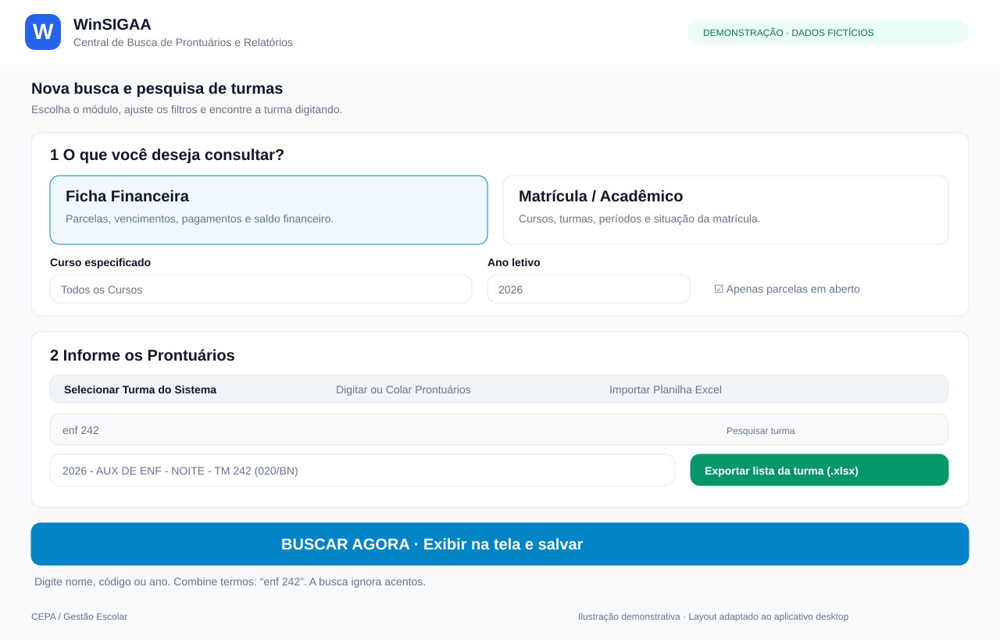
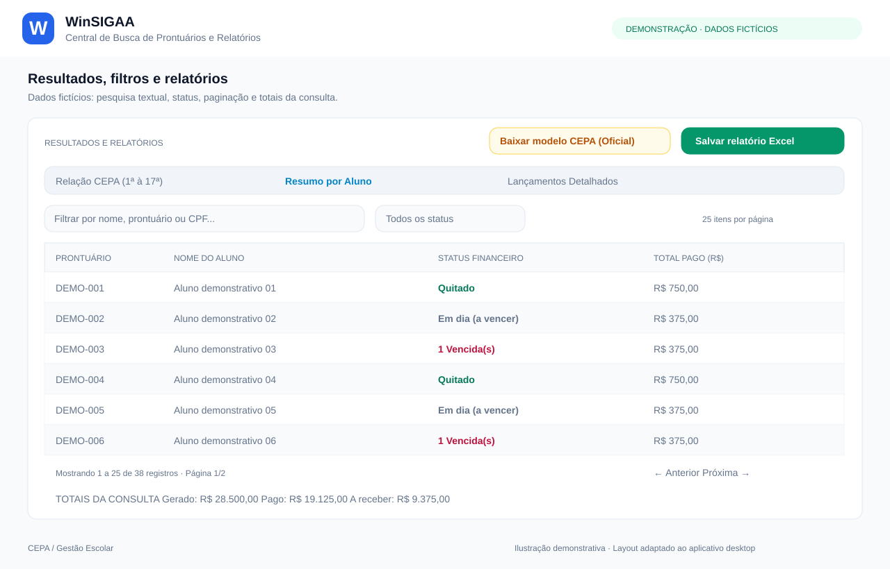

# WinSIGAA — Central de Busca de Prontuários e Relatórios

Aplicativo desktop desenvolvido por Jonas para agilizar consultas acadêmicas e financeiras e a produção de relatórios em rotinas administrativas. **O código-fonte original permanece privado.**

## Funcionalidades
- Consultas de ficha financeira e matrícula acadêmica
- Seleção e pesquisa de turmas, digitação de prontuários e importação de Excel
- Filtros por curso, ano, nome, prontuário, status e paginação
- Resumo por aluno, lançamentos detalhados e totais da consulta
- Exportação de listas e relatórios para Excel

**Tecnologias:** Python 3.11, CustomTkinter, Firebird, pandas e OpenPyXL.

## Demonstração visual

As telas são **ilustrações demonstrativas com dados fictícios**, adaptadas do layout do aplicativo desktop.

### Nova busca e pesquisa de turmas

### Resultados, filtros e relatórios

## Sobre o código
Este repositório documenta o projeto sem publicar o código-fonte, credenciais, informações de alunos ou infraestrutura interna.

[Ver meu portfólio](https://jonascepa09-star.github.io/jonaspessoa.github.io/)